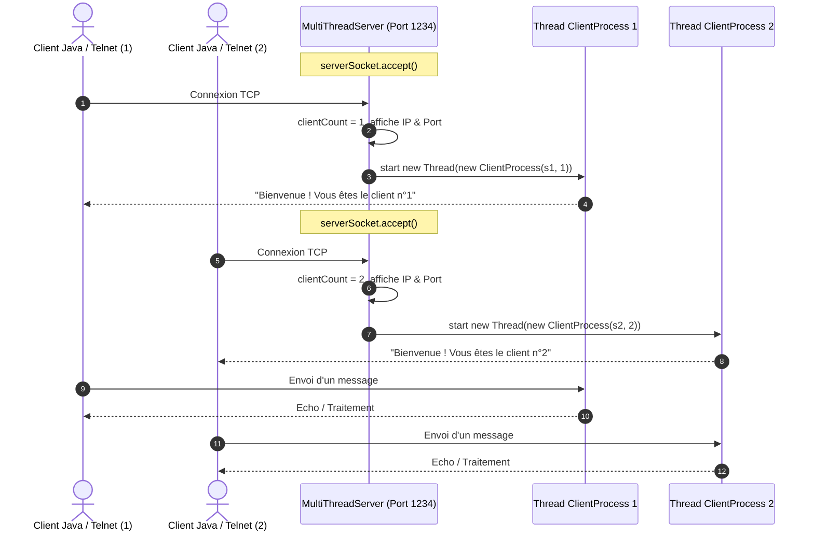

# TP 3 : Serveur Multi-threads - sockets en mode connecté TCP
## Activité 3-1 : Acceptation de plusieurs clients

**Université de Sfax - Faculté des Sciences de Sfax (FSS)**  
**Département d'Informatique et des Communications**  
**Filière :** Auditoire LSI 3 — Année Universitaire 2026 – 2027  
**Matière :** Développement d'applications réparties  
**Enseignants :** Amal ABID (Responsable de cours) / Zeineb DAOUD (Enseignante des TPs)  

---

## 1. Objectifs de l'activité
- Comprendre et mettre en œuvre le modèle d'un serveur TCP multi-thread en Java.
- Gérer la concurrence et la persistance de multiples connexions simultanées via la classe `ServerSocket` et des threads dédiés (`Thread` / `Runnable`).
- Récupérer et afficher les métadonnées de connexion réseau du client (`Socket.getRemoteSocketAddress()`).
- Assigner et transmettre dynamiquement à chaque client un numéro d'ordre de connexion.
- Valider la communication en local (avec Telnet et des clients Java) et sur réseau local (LAN) avec `InetAddress` et `InetSocketAddress`.

---

## 2. Architecture & Organisation du Projet

Le projet suit la structure standard d'un projet Java :

```
TP3_Activite3_1_MultiClient/
├── .gitignore
├── README.md
├── bin/
└── src/
    ├── server/
    │   ├── MultiThreadServer.java   # Serveur principal : écoute, accepte et délègue à un thread
    │   └── ClientProcess.java       # Processus exécutable (Runnable) dédié à chaque client
    └── client/
        └── Client.java              # Client Java utilisant InetSocketAddress pour réseau local
```

### Diagramme de Fonctionnement


---

## 3. Détails d'Implémentation

### Côté Serveur (`MultiThreadServer` & `ClientProcess`)
1. **Écoute et délégation concurrente :**  
   Une boucle infinie `while(true)` attend chaque appel de connexion via `serverSocket.accept()`.
2. **Identification du client :**  
   À chaque nouvelle connexion, un compteur `clientCount` est incrémenté. L'adresse IP et le port éphémère du client sont obtenus grâce à `socket.getRemoteSocketAddress()`.
3. **Isolation par Thread :**  
   Pour chaque client, une instance de `ClientProcess` (implémentant `Runnable`) est créée et exécutée dans un thread indépendant :
   ```java
   ClientProcess process = new ClientProcess(socket, clientCount);
   new Thread(process).start();
   ```
4. **Communication & Libération :**  
   Le serveur transmet le message de bienvenue avec le numéro d'ordre. Dès que le client envoie `quit`, `exit` ou se déconnecte, les flux et le socket sont fermés proprement dans un bloc `finally`.

### Côté Client (`Client`)
- Utilise `InetAddress.getByName(host)` et `InetSocketAddress` pour permettre une connexion flexible (sur `localhost` ou vers une machine distante sur le réseau local).
- Lit le message d'accueil et le numéro d'ordre attribué par le serveur.
- Permet la saisie dynamique en console et affiche la réponse du serveur.

---

## 4. Instructions de Compilation et d'Exécution

### A. Compilation via terminal
```bash
# Compilation de tous les fichiers sources dans le dossier bin
javac -d bin src/server/*.java src/client/*.java
```

### B. Démarrage du Serveur
```bash
java -cp bin server.MultiThreadServer
```

*Sortie console attendue :*
```text
====================================================
 Démarrage du Serveur Multi-thread TCP (Port 1234)
====================================================
Serveur en attente de connexions clientes...
```

### C. Tests Locaux

#### 1. Test avec Telnet
Ouvrez une invite de commandes Windows et tapez :
```bash
telnet localhost 1234
```
*(Si Telnet n'est pas activé : Panneau de configuration → Programmes → Activer des fonctionnalités Windows → Cocher Client Telnet).*

#### 2. Test avec des Clients Java
Dans un ou plusieurs nouveaux terminaux :
```bash
java -cp bin client.Client
```
Ou avec arguments d'adresse IP :
```bash
java -cp bin client.Client 127.0.0.1 1234
```

*Sortie côté Client n°1 :*
```text
====================================================
 Client TCP - Connexion au Serveur
====================================================
Tentative de connexion à 127.0.0.1:1234...
Connecté avec succès au serveur !
[Serveur] Bienvenue ! Vous êtes le client n°1
[Serveur] Tapez vos messages (ou 'quit'/'exit' pour quitter) :

Entrez un message : Bonjour Serveur
[Réponse Serveur] : Serveur a reçu votre message : Bonjour Serveur
```

*Sortie côté Serveur :*
```text
[Connexion acceptée]
 -> Client n°          : 1
 -> Adresse IP & Port  : /127.0.0.1:54321
[Client n°1 - /127.0.0.1:54321] : Bonjour Serveur

[Connexion acceptée]
 -> Client n°          : 2
 -> Adresse IP & Port  : /127.0.0.1:54322
```

### D. Test en Réseau Local (LAN)
1. Récupérer l'adresse IP de la machine serveur (ex: `192.168.1.50`) via la commande `ipconfig`.
2. S'assurer que le port `1234` est autorisé dans le pare-feu Windows de la machine serveur.
3. Sur les autres machines clientes du réseau local, exécuter :
```bash
java -cp bin client.Client 192.168.1.50 1234
```

---

## 5. Synthèse & Analyse
- **Multi-threading vs Mono-thread :** Contrairement au modèle mono-thread (TP1/TP2) où un client bloquait tous les autres, l'instanciation d'un thread par client permet un traitement non-bloquant et simultané.
- **Ressources système :** Chaque thread possède sa propre pile d'exécution (`stack`) et ses flux d'entrée/sortie (`InputStream`, `OutputStream`), garantissant une parfaite indépendance des sessions clients.
